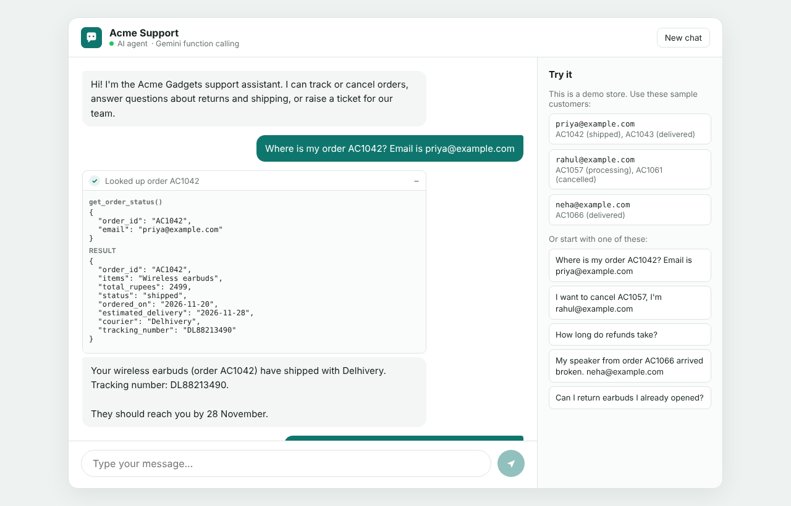

# AI Support Agent

A customer-support agent for a demo electronics store ("Acme Gadgets"). It uses **Gemini function calling** to look up orders, cancel them, search help articles and open tickets, and shows every tool call it made in the chat. The same tools are also exposed through an **MCP server**, so desktop AI clients like Claude Desktop or Cursor can use them directly.



## What it can do

| Tool | What it does |
|---|---|
| `get_order_status` | Status, items, delivery estimate and tracking number (needs order ID **and** matching email) |
| `list_orders` | All orders for an email |
| `cancel_order` | Cancels an order that hasn't shipped yet. The agent must get the customer's confirmation first |
| `search_faq` | Searches help articles on returns, refunds, shipping, warranty and payments |
| `create_ticket` | Hands the issue to a human with a ticket ID (damaged items, payment problems, anything else) |

Orders and tickets are stored in SQLite and seeded with sample data on first run.

## How the agent works

```
user message + history
        │
        ▼
 Gemini (system prompt + 5 tool declarations)
        │
        ├── text?  ──► reply to user
        │
        └── function calls? ──► run each tool in Python
                                 │
                                 └── send results back to Gemini ─► (loop, max 6 steps)
```

- **The loop is written by hand** (`app/agent.py`) instead of using the SDK's automatic function calling. That makes it possible to record each step (tool, arguments, result) and return it to the UI, and to cap the number of steps so a confused model can't loop forever.
- **Tools never raise.** They return `{"error": "..."}`, which the model reads and explains to the customer ("that order has already shipped, so it can't be cancelled, but you can return it").
- **Order lookups need the email that placed the order**, and a wrong email gets the same message as a missing order. Otherwise anyone could look up other people's orders by guessing IDs.
- **Confirmation before actions.** The system prompt requires the agent to explain and get a clear "yes" before calling `cancel_order`.
- **The API is stateless.** The frontend sends the conversation history with each message, so the backend doesn't need sessions.

## MCP server

`app/mcp_server.py` registers the same five Python functions with the [Model Context Protocol](https://modelcontextprotocol.io) Python SDK. Tool schemas are generated from the type hints and docstrings.

```bash
cd backend
python -m app.mcp_server          # stdio (for Claude Desktop, Cursor, ...)
python -m app.mcp_server --http   # streamable HTTP on port 8001
```

Claude Desktop config (`claude_desktop_config.json`):

```json
{
  "mcpServers": {
    "acme-support": {
      "command": "/full/path/to/backend/.venv/bin/python",
      "args": ["-m", "app.mcp_server"],
      "cwd": "/full/path/to/backend"
    }
  }
}
```

You can also inspect it with `npx @modelcontextprotocol/inspector`.

## Tech stack

- **Backend:** Python 3.11+, FastAPI, Pydantic, SQLite
- **AI:** Google Gemini API (`google-genai` SDK) with function calling
- **MCP:** official `mcp` Python SDK
- **Frontend:** React 18, Vite, plain CSS
- **Tests:** pytest; Gemini is replaced with scripted responses so the agent loop is tested offline

## Running locally

Get a free Gemini API key at [Google AI Studio](https://aistudio.google.com/apikey).

```bash
# backend
cd backend
python -m venv .venv && source .venv/bin/activate
pip install -r requirements.txt
cp .env.example .env              # add your key
uvicorn app.main:app --reload     # http://localhost:8000

# frontend (new terminal)
cd frontend
npm install
npm run dev                       # http://localhost:5173
```

Run the tests with `cd backend && pytest`.

The "Try it" panel lists the sample customers and orders. A few things to try:

- *Where is my order AC1042? Email is priya@example.com*
- *I want to cancel AC1057, I'm rahul@example.com* (it will ask you to confirm)
- *Can I cancel AC1042 instead?* (already shipped, so it explains the return option)
- *My speaker from AC1066 arrived broken* (creates a ticket)

## Project structure

```
backend/
  app/
    main.py         FastAPI app and /api/chat
    agent.py        system prompt + function-calling loop
    tools.py        the 5 tools and their JSON schemas
    mcp_server.py   MCP server exposing the same tools
    db.py           SQLite schema and sample data
    faq.py          help articles
  tests/
frontend/
  src/
    App.jsx                  chat UI
    components/ToolSteps.jsx expandable "what the agent did" list
    components/DemoPanel.jsx sample customers and prompts
```

## Ideas for later

- Stream the reply and tool steps as they happen (server-sent events)
- Real customer login instead of email matching
- Embedding-based search for the help articles once there are more of them
- Hand-off to a human inside the same chat when a ticket is created
